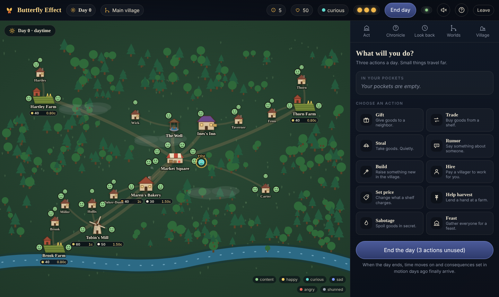
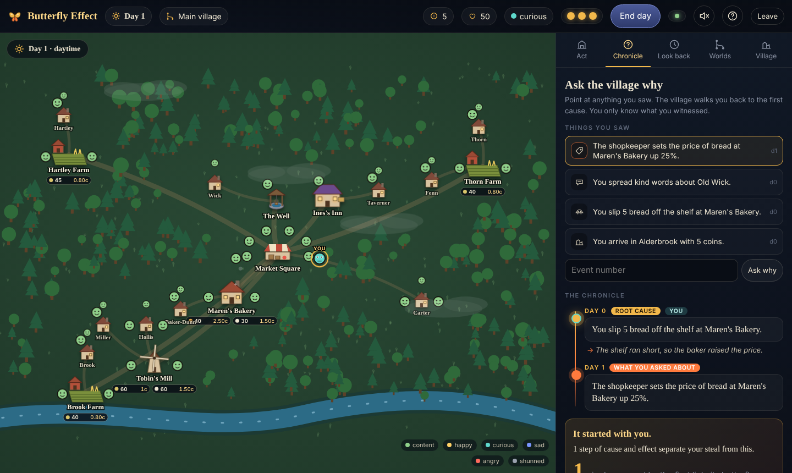
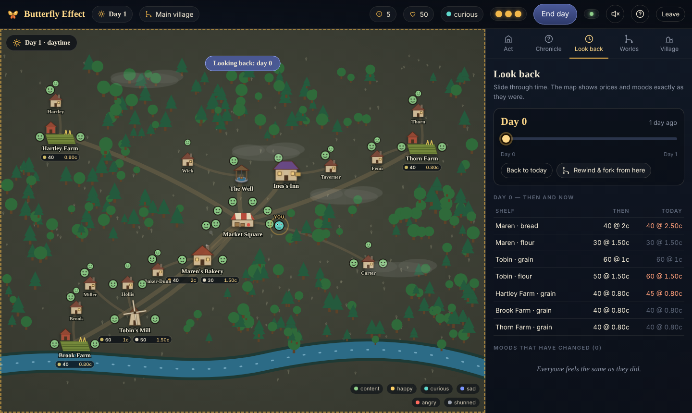

# Butterfly Effect

> A living village where every action leaves a trace. A DBMS course project.

You arrive in **Alderbrook**, a village of about thirty villagers, and do ordinary things: buy bread, lend a coin, steal a loaf, spread a rumor. The village quietly reacts, and days later something happens that you never saw coming. Then you can ask the village one question — **"Why did this happen?"** — and it walks you back, step by step, to the small thing you did.

The game is only the story on top. **PostgreSQL is the engine and the source of truth**: an append-only, hash-chained event store, a causal graph queried with recursive CTEs, rules stored as data, row-level security, branching timelines, time travel, and full recovery from the event log.



| Ask Why (Chronicle) | Look Back + Parallel villages |
|---|---|
|  |  |

## Quick start

### Option A — full game with PostgreSQL

Requirements: PostgreSQL 16+, Node.js 20+.

```powershell
# Windows PowerShell
$env:PGPASSWORD = "your_postgres_password"
powershell -ExecutionPolicy Bypass -File scripts/setup.ps1
cd backend; npm start          # http://localhost:4000
```
```bash
# Linux / macOS / WSL
PGPASSWORD=... ./scripts/setup.sh
cd backend && npm start
```
No local PostgreSQL? `docker compose up -d db`, then `cd backend && cp .env.example .env && npm install && npm start`.

### Option B — UI demo without a database

```bash
cd backend && npm install && npm run mock      # http://localhost:4100
```
An in-memory server that speaks the same API (simplified rules) so you can try or present the interface anywhere. It is **not** the game engine; the real logic is in `db/`.

## What is where

| Folder | Contents |
|---|---|
| `db/schema`, `db/procedures`, `db/views`, `db/security`, `db/seed` | The database: DDL, engine, views, roles and RLS, seed village |
| `db/tests` | 13 SQL test suites (`scripts/run_tests.ps1` / `.sh` run each on a fresh database) |
| `db/demo` | Seven narrated SQL demos (first evening, ripple, Ask Why, parallel villages, tamper, rebuild) |
| `backend/` | Node/Express API + WebSocket relay (`npm start`), plus `dev/mock-server.mjs` |
| `frontend/` | Plain-JS single-page UI with an SVG village map (no build step) |
| `experiments/` | Eight experiments with scripts, raw CSVs and logs |
| `docs/` | Report (`docs/report`), slides (`docs/slides`), ER diagram and normalization proof (`docs/er`), concept matrix, demo script, screenshots |

## The eight experiments

| # | Experiment | Headline result |
|---|---|---|
| 1 | Last loaf, many players | Naive read-then-write sells 900 loaves that do not exist; row locks, atomic UPDATE, optimistic and SERIALIZABLE are correct |
| 2 | Deadlock | Opposite lock order aborts 64 of 100 transfers; consistent order aborts 0 |
| 3 | Ask Why at scale | Recursive CTE vs closure table vs materialized path: read/write trade-off |
| 4 | Time travel / branching | Fork cost: replay grows with history, snapshot+delta ~40 ms, copy-on-write cheapest |
| 5 | Index impact | Engine write path 146 s → 0.19 s at 1M events |
| 6 | Tamper and peek | Hash-chain verifier catches an edited row; RLS hides unwitnessed events (tests 02, 09) |
| 7 | Crash and rebuild | Crash recovery, point-in-time recovery, and a full rebuild all reproduce the same state digest |
| 8 | Partitioning | Partition pruning and cheap retirement of a village (`experiments/partitioning`) |

## Playing

Each day you have **three actions**: gift, trade, steal, rumor, build, hire, set price, help harvest, sabotage, feast. Click **End day** and the Evening Bell tells you what changed. Use **Chronicle** to ask why, **Look back** to slide through time, **Worlds** to fork a parallel village and compare it. Play with friends by opening the same server in another browser.

## Verified status (honest notes)

- The SQL, experiments and their results were produced and run against PostgreSQL 16 during development; raw outputs are in `experiments/results/`.
- The front end and the demo server were exercised end to end in a headless browser (join, act, end day, Evening Bell, Ask Why, Look Back, fork, compare, leaderboard, responsive layout). That test environment had no PostgreSQL, so the **new Express routes in `backend/src/routes/world.js` and the modified routes in `queries.js` have been syntax-checked but not run against a live database**. Run `scripts/setup.ps1`, `npm start` and click through once before the demo; `docs/demo_script.md` has the checklist.
- `experiments/partitioning/exp8_partitioning.sql` is written but its numbers have not been produced yet; run `run_experiment8.ps1` and paste the table into report §14.
