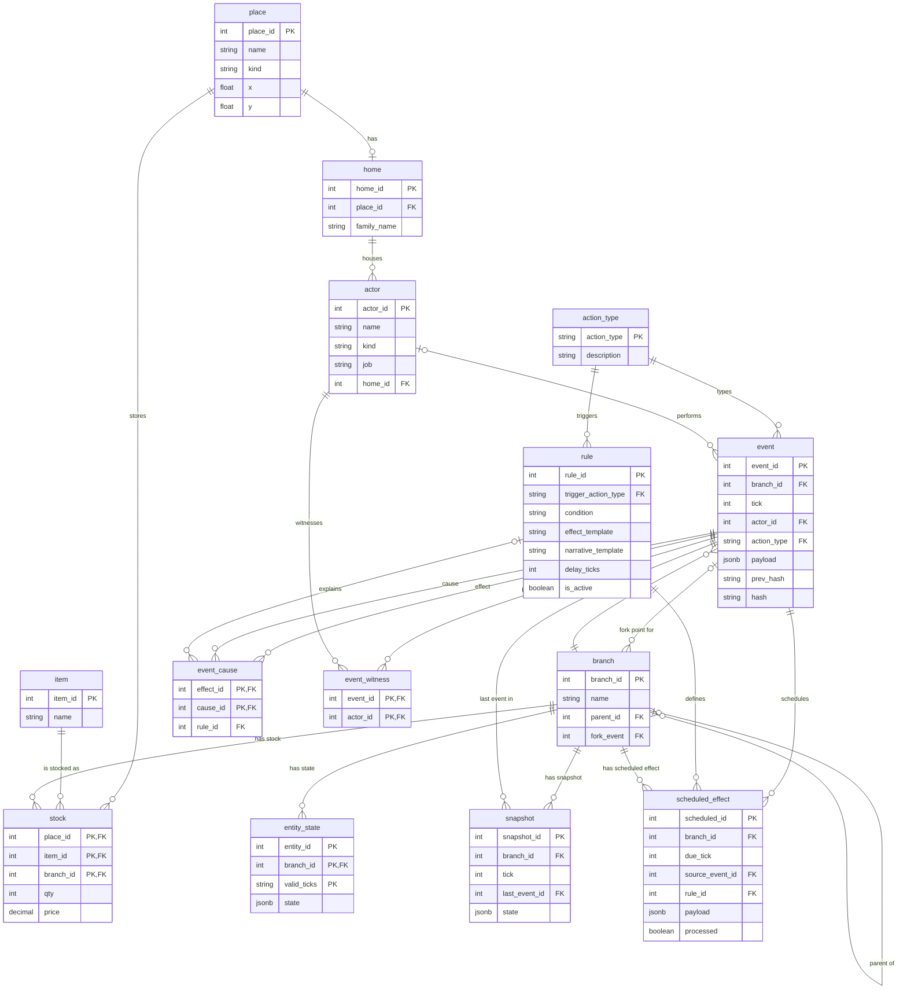

## Design decisions

| # | Decision | Reason |
|---|---|---|
| 1 | Changing values (mood, trust, coins held) live in entity_state, not in actor. | This keeps mutable values branch-specific and separate from an actor's identity. |
| 2 | event.payload is JSONB because each action type has a different shape. | JSONB accommodates action-specific fields without changing the event structure. |
| 3 | event_cause is the M:N link between events (causal graph). | It records multiple causes for effects and multiple effects for each cause. |
| 4 | event_witness is the M:N link between events and actors (who knew what). | It captures which actors witnessed each event and which events each actor witnessed. |
| 5 | branch references itself to form a tree of parallel villages. | A parent reference connects each child branch to its originating branch. |
| 6 | stock primary key includes branch_id so each branch has its own stock. | Including branch_id allows the same place and item to have distinct stock records in different branches. |
| 7 | entity_state.entity_id is polymorphic with no FK (it can refer to an actor, place or item). | A single entity identifier supports state for all three entity kinds without a foreign key to only one table. |
| 8 | action_type uses a text primary key because it is a small, stable, readable lookup. | Text keys keep action type references readable and directly tied to stable lookup values. |
